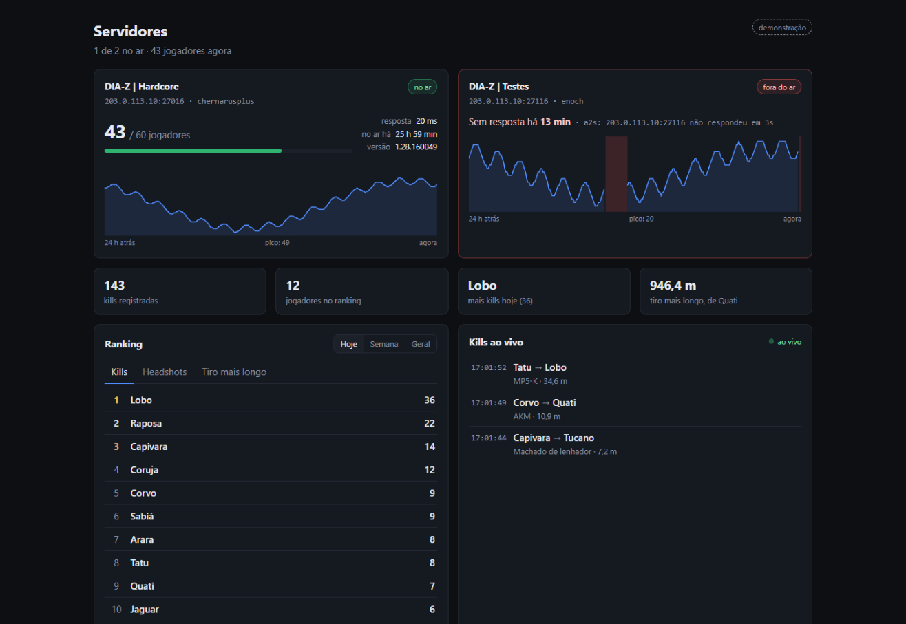

# Painel ao vivo dos servidores

Front-end em React + TypeScript que junta dois serviços meus numa tela só:

- [a2s-monitor](https://github.com/edudiasr/a2s-monitor) (Go): se cada servidor está no ar,
  quantos jogadores tem e o histórico das últimas 24 h
- [realtime-leaderboard-redis](https://github.com/edudiasr/realtime-leaderboard-redis) (Python + Redis):
  ranking por dia, semana e geral, e as kills chegando ao vivo por Server-Sent Events

**[Ver a demonstração](https://edudiasr.github.io/server-dashboard/)**: a versão publicada usa
dados gerados no próprio navegador, porque o GitHub Pages não tem as APIs por trás.



## O que tem na tela

- um cartão por servidor: no ar ou fora (e desde quando), jogadores/vagas, tempo de resposta,
  versão e o gráfico de jogadores nas últimas 24 h. Os trechos em que o servidor estava fora
  aparecem como faixa vermelha, e a linha é interrompida neles em vez de cair a zero, que daria
  a impressão de servidor vazio e não fora do ar.
- resumo: kills registradas, jogadores no ranking, quem mais matou hoje, tiro mais longo
- ranking com 3 métricas × 3 períodos
- kills ao vivo, com o estado da conexão (conectando, ao vivo, reconectando)
- ficha do jogador ao clicar em qualquer nome: kills, mortes, K/D e posição em cada ranking

## Decisões

**Uma interface, duas fontes.** A tela fala com um `DataSource` (`src/api/types.ts`). Existe a
implementação HTTP, que fala com as APIs de verdade, e a de demonstração. Os testes usam uma
terceira, controlada pelo teste. Nenhum componente sabe de onde o dado vem.

**Sem CORS.** As chamadas vão pra caminhos relativos (`/api/monitor`, `/api/ranking`). Em
desenvolvimento o Vite repassa pras APIs; no [docker-compose](https://github.com/edudiasr/game-server-stack)
quem repassa é o Nginx. O navegador só vê uma origem.

**API fora do ar não apaga a tela.** O hook `usePolling` guarda o último dado bom e mostra o erro
ao lado. Um soluço do monitor não transforma o painel numa tela branca. Trocar de aba no ranking
cancela a busca anterior (`AbortController`), pra resposta atrasada da aba velha não sobrescrever a nova.

**Kill nova atualiza o ranking na hora.** Em vez de esperar o próximo ciclo de 30 s, cada evento
do SSE muda a chave do polling do ranking e do resumo, e eles buscam de novo.

**Gráfico em SVG puro.** Uma série, uma área e faixas de queda: uma biblioteca de gráficos
adicionaria mais de 100 kB pra isso. O bundle inteiro fica em 74 kB com gzip.

**Ficha do jogador com `<dialog>` nativo.** Foco preso dentro do modal, Esc pra fechar e fundo
escurecido vêm do navegador, sem biblioteca.

**A demonstração é coerente.** O `DemoSource` gera kills com uma semente fixa e calcula o ranking a
partir delas. A soma das kills do ranking bate com o total do resumo, e tem teste pra isso.

## Testes

19 testes com Vitest e Testing Library, consultando os elementos como o usuário enxerga
(papel e nome acessível, não classe CSS):

- trocar métrica e período pede o ranking certo, e erro com dado anterior mantém o dado na tela
- kills ao vivo entram no topo e a lista não passa de 25
- cada kill nova recarrega ranking e resumo
- gráfico desenha uma faixa por queda e não liga a linha por cima dela
- servidor fora mostra há quanto tempo e o erro
- monitor fora do ar mostra o aviso
- clicar no nome abre a ficha com K/D e posições
- demonstração: ranking coerente com as kills, determinística, para de emitir quando ninguém escuta

```bash
npm test
```

## Rodando

```bash
npm install
npm run dev                       # http://localhost:5173  (?demo na URL usa dados de demonstração)
```

Com as APIs rodando (por padrão `localhost:9105` e `localhost:8000`; dá pra mudar com
`MONITOR_URL` e `RANKING_URL`), o painel mostra os dados de verdade.

```bash
npm run build                     # dist/ apontando pras APIs
npm run build:demo                # dist/ com a demonstração (o que vai pro GitHub Pages)
```

## Estrutura

```
src/
  api/          tipos, fonte HTTP e fonte de demonstração
  hooks/        usePolling (busca periódica que sobrevive a erro) e useKillFeed (SSE)
  components/   ServerCard, PlayersChart, Leaderboard, KillFeed, PlayerPanel
  lib/          formatação em pt-BR
  test/         testes e a fonte falsa usada neles
```

## Licença

MIT
